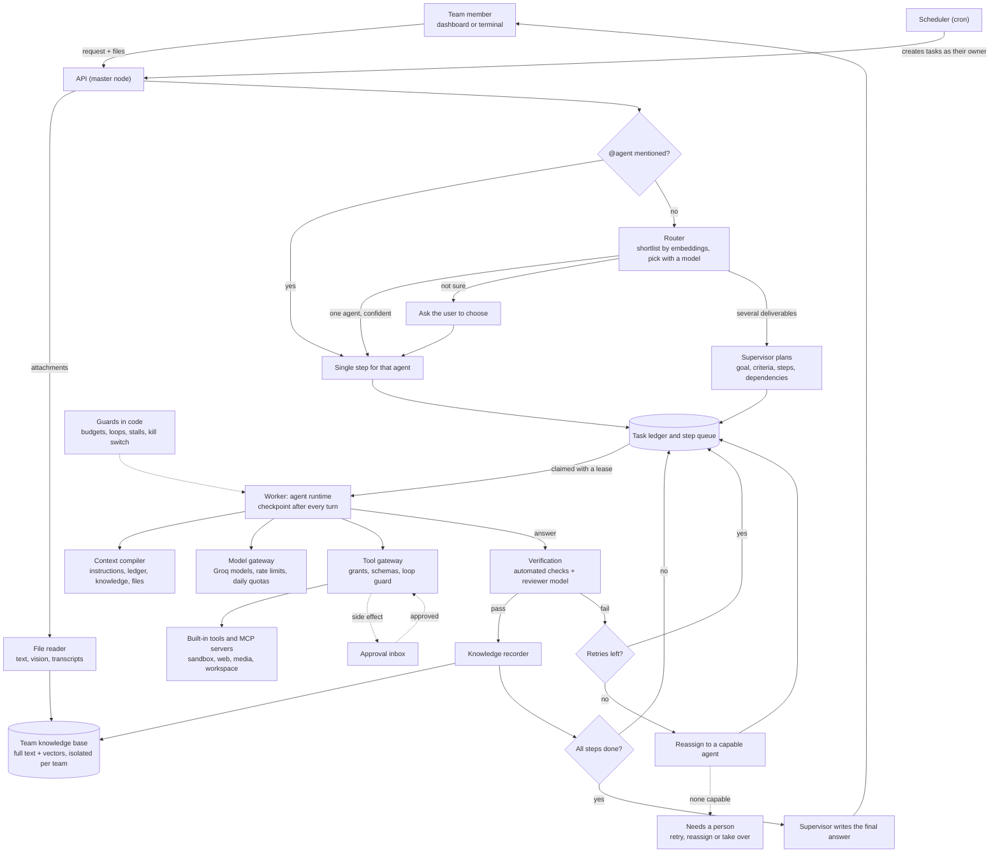

# Memy — multi-agent orchestration platform

A self-hosted platform where a team works with a set of specialised AI agents through one chat-first dashboard.
Agents share one knowledge base and one task ledger, so any agent (or person) can pick up any task, and every step is
checkpointed, verified, costed and recorded as knowledge.

The design rationale lives in [`Multi-Agent Orchestration Platform — Design & Decisions.pdf`](Multi-Agent%20Orchestration%20Platform%20—%20Design%20&%20Decisions.pdf);
this README covers what is built and how to run it.

**Contents:** [Requirements](#requirements) · [1. Install the tools](#1-install-the-tools) ·
[2. Get API keys](#2-get-api-keys) · [3. Set up and start](#3-set-up-and-start) · [4. First steps](#4-first-steps) ·
[How it works](#how-it-works) · [Features](#features) · [Agents](#agents) · [Limits and quotas](#limits-and-quotas) ·
[Verifying](#verifying-it-works) · [Troubleshooting](#troubleshooting) · [Repository layout](#repository-layout)

## Requirements

| | Minimum | Notes |
|---|---|---|
| OS | Windows 10/11, macOS 12+, or a recent Linux (Ubuntu 22.04+, Debian 12+, Fedora 38+) | Windows uses Docker Desktop on WSL 2 |
| Memory | 8 GB RAM (4 GB available to Docker) | No local LLM runs on your machine; models are hosted |
| Disk | ~10 GB free | Docker images and data |
| Accounts | A **Groq** API key (free) | Required — every agent runs on Groq |
| | An **ElevenLabs** API key | Optional — speech, sound effects, transcription, music, image, video |

## 1. Install the tools

The setup scripts in step 3 check every tool and can install the missing ones for you. To install them yourself:

<details open>
<summary><b>Windows 10 / 11</b></summary>

1. Open **PowerShell as Administrator** and enable WSL 2 (Docker Desktop runs on it), then restart:
   ```powershell
   wsl --install
   ```
2. Install Docker Desktop, Git and uv (uv runs the terminal client and the eval scripts):
   ```powershell
   winget install -e --id Docker.DockerDesktop
   winget install -e --id Git.Git
   winget install -e --id astral-sh.uv
   ```
   No winget? Download [Docker Desktop](https://www.docker.com/products/docker-desktop/), [Git](https://git-scm.com/download/win) and [uv](https://docs.astral.sh/uv/getting-started/installation/) instead.
3. Start **Docker Desktop** once and wait until it shows *Engine running*. In *Settings › Resources*, give it at least 4 GB of memory.
4. Open a new terminal and check:
   ```powershell
   docker --version; docker compose version; git --version; uv --version
   ```
</details>

<details>
<summary><b>macOS</b></summary>

1. Install [Homebrew](https://brew.sh) if you don't have it, then:
   ```bash
   brew install --cask docker
   brew install git uv
   ```
2. Open **Docker** from Applications and wait until the engine is running (give it at least 4 GB of memory in *Settings › Resources*).
3. Check: `docker --version && docker compose version && git --version && uv --version`
</details>

<details>
<summary><b>Linux</b></summary>

1. Install Docker Engine and the Compose plugin with Docker's convenience script, then let your user run Docker:
   ```bash
   curl -fsSL https://get.docker.com | sh
   sudo usermod -aG docker "$USER"     # then log out and back in
   sudo systemctl enable --now docker
   ```
2. Install Git and uv:
   ```bash
   sudo apt install -y git            # or: sudo dnf install -y git
   curl -LsSf https://astral.sh/uv/install.sh | sh
   ```
3. Check: `docker --version && docker compose version && git --version && uv --version`
</details>

## 2. Get API keys

**Groq (required)**
1. Sign in at [console.groq.com](https://console.groq.com) and open **API Keys › Create API key**.
2. Copy the key (starts with `gsk_`). The setup script asks for it.

**ElevenLabs (optional)**
1. Sign in at [elevenlabs.io](https://elevenlabs.io) and open **Developers › API keys › Create**.
2. Grant only what Memy uses:

   | Permission | Level | Used for |
   |---|---|---|
   | Text to Speech | Access | speech (agents and Studio) |
   | Speech to Text | Access | ElevenLabs transcription (Groq Whisper is the default) |
   | Sound Effects | Access | sound effects |
   | Music Generation | Access | music (paid plan) |
   | Image & Video Generation | Access | images and video (Pro plan) |
   | Voices | Read | voice list and previews |
   | User | Access | the credits meter in Studio |

## 3. Set up and start

```bash
git clone https://github.com/Bishnu2430/MEMY.git
cd MEMY
```

Then run the setup script for your system:

**Windows (PowerShell)**
```powershell
powershell -ExecutionPolicy Bypass -File scripts\setup.ps1
```

**macOS / Linux**
```bash
chmod +x scripts/setup.sh
./scripts/setup.sh
```

The script:
1. checks Docker, Docker Compose, Git and uv, and offers to install any that are missing (winget, Homebrew or the official installers);
2. starts the Docker engine if needed and checks memory and free ports (8080, 8000);
3. creates `.env` from `.env.example`, generates every secret (database passwords, JWT secret, encryption key, demo account passwords) and asks for your API keys with hidden input — existing values are always kept;
4. builds and starts all services (`docker compose up -d --build`; the first run downloads about 3 GB);
5. waits until the platform is healthy and prints where to sign in.

Options: `--groq-key` / `-GroqKey`, `--elevenlabs-key` / `-ElevenLabsKey`, `--install` / `-Install` (install missing tools without asking),
`--no-start` / `-NoStart` (prepare `.env` only), `--rebuild` / `-Rebuild` (no build cache), `-y` / `-Yes` (no prompts).
Re-running the script is safe; it is also how you apply updates after `git pull`.

<details>
<summary>Manual setup (without the script)</summary>

```bash
cp .env.example .env    # fill in every empty value; MASTER_KEY must be base64 of 32 random bytes
docker compose up -d --build
```
Generate values with `openssl rand -base64 24` (passwords) and `openssl rand -base64 32` (`MASTER_KEY`).
</details>

## 4. First steps

1. Open **http://localhost:8080** and sign in as `admin@memy.local` — the password is `SEED_ADMIN_PASSWORD` in `.env`.
2. In **Chat**, ask something, or mention an agent: `@coder write a function that checks if a string is a palindrome, with tests`.
   Attach files with the paperclip, drag-and-drop or paste.
3. Watch **Live trace**: which agent, on which model, is doing what, with live tokens and cost.
4. Actions with side effects (for example `@ops post 'hello' to #general`) wait in **Approvals**.
5. Everything an agent produces is saved to **Knowledge**; media goes to the **Studio** gallery and code to **Projects**.

Useful commands: `docker compose logs -f api orchestrator worker` (logs), `docker compose down` (stop),
`uv run cli/hub.py login` (terminal client: `chat`, `run @coder "…"`, `live`, `approvals`, `approve <id>`).

## How it works



1. **Intake.** A request arrives from the dashboard, the terminal client or a schedule. Attached files are read
   (PDF/doc text, image descriptions by a vision model, audio transcripts) and added to the team's knowledge.
2. **Routing.** An `@mention` goes straight to that agent. Otherwise the router shortlists agents by meaning and a
   model picks one; when unsure it asks you, and when the request has several deliverables the supervisor plans steps
   with dependencies.
3. **Execution.** Workers claim ready steps with a lease and run the agent as a graph that checkpoints after every turn,
   so if a worker dies another resumes from the last checkpoint. The context compiler rebuilds each prompt from layered
   instructions, the task ledger, retrieved team knowledge and attached files.
4. **Models and tools.** The model gateway picks a hosted model with capacity (per-minute and daily quotas are tracked)
   and meters every call. The tool gateway checks grants and arguments; side-effecting tools wait for a person to approve.
5. **Verification.** Automated checks run first (sandboxed tests, citations, diagram compilation, media), then a reviewer
   from a different model family. Failures go back with notes, then to another capable agent, then to a person.
6. **Knowledge.** Every accepted step and finished task is recorded in the knowledge base, so later tasks build on it.
7. **Guards.** Budgets, loop detection, stall detection and a kill switch are enforced in code, never by prompts.

| Service | Role |
|---|---|
| `web` | React dashboard behind nginx (published on port 8080) |
| `api` | FastAPI master node: auth, REST + live events, approvals, uploads, media studio (also on `127.0.0.1:8000` for the CLI) |
| `orchestrator` | Control loop: routing, supervisor planning, dispatch, verification, retries, guards, scheduler, knowledge recording |
| `worker` ×2 | Agent runtime: leased steps, LangGraph with Postgres checkpoints, up to 3 concurrent steps each |
| `db` | PostgreSQL 17 + pgvector: accounts, ledger, events, knowledge (row-level security per team), checkpoints, usage |
| `embedder` | Small ONNX embedding model (`bge-small-en-v1.5`) for search — not an LLM |
| `sandbox` | Code runner on an internal network with no internet, read-only filesystem and resource limits |
| `renderer` | Mermaid → SVG renderer |

## Features

- **Chat** — describe a task, optionally `@mention` an agent, attach files; the live trace shows while it runs, and each
  answer lists the knowledge it saved. Stop any task, run it again, copy or download answers.
- **Live trace** — every active step: agent, model, current operation, waits, tokens and cost as they happen.
- **Tasks** — the ledger (goal, criteria, steps, verification checks), event timeline, attached files, outputs and knowledge.
  Retry, reassign or take over any step.
- **Approvals** — exact tool and arguments for every side-effecting action.
- **Projects** — files agents wrote into the team's project workspace.
- **Studio** — speech (voice picker with previews), sound effects, music, images, video, transcripts and diagrams, with a gallery.
- **Knowledge** — search, add documents, pages and notes, review memory proposals, inspect stored chunks and provenance.
- **Agents** — edit configuration, compare and restore versions, clone for a team, pause, try in a playground.
- **Tools & MCP** — connect MCP servers, test before saving, pinned tool definitions, per-team grants, encrypted secrets.
- **Usage** — tokens per day by model, cost by agent, response times, quality per agent, budgets, daily model quota.
- **Admin** — access matrix, people and roles, team budgets, provider keys (encrypted), instruction pool, kill switch, audit log.

## Agents

| Agent | Does | Model |
|---|---|---|
| `@generalist` | questions, explanations, summaries | GPT-OSS 20B |
| `@researcher` | cited research from web pages and team knowledge | GPT-OSS 20B |
| `@coder` | Python with tests, run in the sandbox, written to the project workspace | GPT-OSS 120B |
| `@frontend` | React / HTML / CSS written to the project workspace | GPT-OSS 120B |
| `@reviewer` | code and security review | Qwen 3.8 27B |
| `@diagrammer` | Mermaid diagrams compiled to SVG with a repair loop | GPT-OSS 20B |
| `@designer` | images and video (ElevenLabs), SVG illustrations | GPT-OSS 120B |
| `@narrator` | speech, sound effects, music, transcription (ElevenLabs) | GPT-OSS 20B |
| `@ops` | team announcements (approval required), shared notes, time | GPT-OSS 20B |

Agents are YAML files in `agents/`; editing one in the UI creates a new version. A changed seed file updates an agent
only if nobody has edited it in the UI since.

## Limits and quotas

- **Groq free tier:** about 8,000 tokens per minute and 200,000 tokens per day per model (rolling 24 hours). The gateway
  spreads work across the three models, waits visibly for per-minute capacity, and stops with a clear message when the
  daily quota is spent. **Usage › Daily model quota** shows where each model stands. A paid Groq tier or another
  OpenAI-compatible provider (add it in `infra/models.yaml`) lifts the limit.
- **ElevenLabs:** speech, voices, sound effects and transcription work on the free plan (10,000 credits a month). Music,
  image and video need a paid plan and the *Image & Video* permission; Memy reports this plainly and the designer agent
  falls back to SVG illustrations.

## Verifying it works

```bash
uv run evals/run_all.py             # team isolation, MCP pinning, budget stop, approvals, prompt injection, worker-kill hand-off
uv run evals/features.py            # attachments, knowledge recording, MCP probe, project workspace, studio
uv run evals/routing_eval.py        # routing accuracy on a labelled set
uv run evals/simulate_ecommerce.py  # a 4-person team builds a small store through the app; writes evals/reports/
```

## Troubleshooting

| Symptom | Fix |
|---|---|
| Sign-in shows "server is restarting or unreachable" | Wait a few seconds after a restart; check `docker compose ps` and `docker compose logs api`. |
| Port 8080 or 8000 already in use | Stop the other program, or change the published ports in `docker-compose.yml`. |
| Tasks stop with "Daily token quota reached" | The Groq free tier's daily allowance is spent; see [Limits and quotas](#limits-and-quotas). Retry later from the task page. |
| Builds are slow or containers are killed | Give Docker at least 4 GB of memory (*Docker Desktop › Settings › Resources*). |
| `permission denied ... docker.sock` (Linux) | Run `sudo usermod -aG docker $USER`, then log out and back in. |
| Image / video / music fails with a plan message | Enable *Image & Video Generation* on the ElevenLabs key and use a Pro plan. |
| Changed `.env` but nothing happened | Re-run the setup script (or `docker compose up -d`) so containers pick up the new values. |

## Repository layout

```
agents/      seed agent configurations (YAML)
skills/      Agent Skills folders (SKILL.md)
infra/       model aliases and quotas, scraping policy, database init, MCP demo config
scripts/     setup.sh (macOS/Linux) and setup.ps1 (Windows)
services/    app/ (api, orchestrator, worker, gateway, runtime, tools, MCP servers), sandbox/, renderer/, embedder/
web/         React + Vite dashboard
cli/         terminal client
evals/       end-to-end checks against the running stack, and reports
```

See [CHANGELOG.md](CHANGELOG.md) for what changed between versions.
